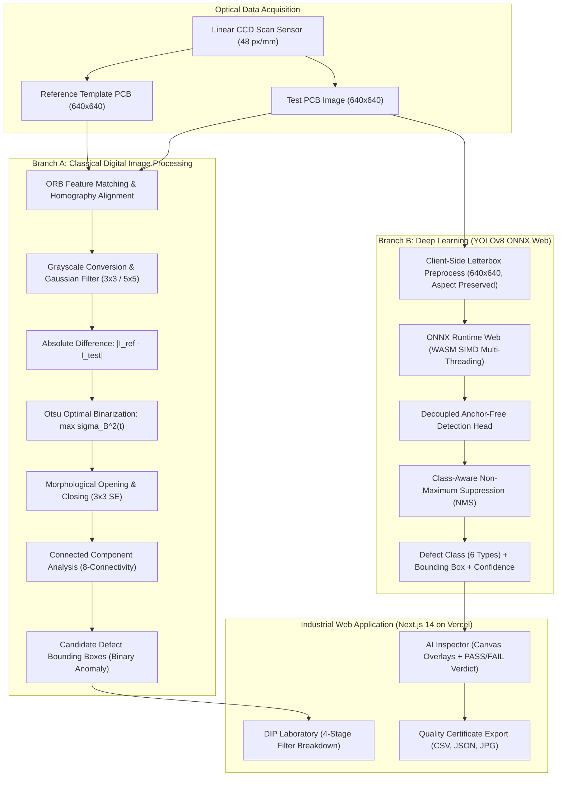

# PCB Vision AI: Intelligent Printed Circuit Board Defect Detection and Classification Using Digital Image Processing and Deep Learning

**ECE Final-Year Academic Capstone Thesis & Defense Documentation**  
**Department of Electronics & Communication Engineering**  
**Project Workspace:** `E:\PCB-Vision-AI`  
**GitHub Repository:** `https://github.com/skmdshariff143-ai/PCB-Vision-AI`  
**Live Production Deployment:** `https://pcb-vision-ai-ten.vercel.app`  
**Date:** October 2026  

---

## 1. Professional Project Abstract

Printed Circuit Boards (PCBs) constitute the core physical interconnect for all modern electronic systems, spanning consumer electronics, automotive control units, avionics, medical instrumentation, and high-performance computing. Surface defect escape during board fabrication introduces severe reliability risks, intermittent signal corruption, and catastrophic field failures. Conventional Automated Optical Inspection (AOI) systems predominantly rely on classical Digital Image Processing (DIP) techniques, specifically template matching and pixel subtraction. While effective for simple geometric discrepancies under tightly controlled laboratory conditions, classical methods suffer from three critical bottlenecks: high sensitivity to ambient illumination gradients, false alarms induced by sub-pixel mechanical vibration or slight positional shifts, and an inherent inability to classify detected anomalies into semantic failure categories.

This project delivers **PCB Vision AI**, an academically rigorous and reproducible comparative framework that investigates, implements, and benchmarks both classical reference-based Digital Image Processing and modern single-image Deep Learning (YOLOv8) architectures for bare PCB defect inspection. Using the canonical **DeepPCB** benchmark dataset comprising 1,500 image pairs (640×640 resolution) and 10,013 defect instances across 11 distinct PCB groups, the system classifies defects across six standard industrial failure modes: **open circuit, short circuit, mouse bite, spur, spurious copper, and pin hole**. 

To prevent data leakage, a strict group-based partitioning protocol was enforced (Train: 1,070 images, Validation: 253 images, Held-Out Test: 177 images). The deep learning model achieved **92.46% Precision, 94.48% Recall, 95.64% mAP@50, and 76.18% mAP@50-95** on the held-out test set. To eliminate cloud hosting costs and guarantee data privacy, the model was compiled to the Open Neural Network Exchange (ONNX) format (12.2 MB) and deployed via **ONNX Runtime Web (WebAssembly SIMD)** on Vercel, enabling client-side browser inference in ~60–85 ms without requiring server compute.

---

## 2. Problem Statement

Automated Optical Inspection for printed circuit boards presents distinct engineering challenges:
1. **Extreme Scale Variance:** Defect features (such as microscopic pin holes and mouse bites) span as few as 8 to 25 pixels within a 640×640 field, requiring convolutional architectures to retain fine-grained spatial representations.
2. **Template Dependence in Classical AOI:** Traditional AOI requires storing, retrieving, and sub-pixel aligning a golden reference template for every unique board layout. Mechanical conveyor wobble inevitably generates false positive edge difference artifacts.
3. **Absence of Semantic Categorization in DIP:** Image subtraction produces binary change masks but cannot determine whether an anomaly represents a fatal short circuit, a non-fatal spur, or a cosmetic artifact.
4. **Data Leakage in Published Literature:** Many research studies randomly shuffle cropped sub-images of the same board across splits, resulting in artificially high accuracy due to background pattern memorization.

---

## 3. Project Objectives

1. **Implement an End-to-End Classical DIP Pipeline:** Implement sub-pixel ORB feature matching and RANSAC homography, 2D Gaussian smoothing, absolute differencing, Otsu's optimal binarization, morphological opening/closing, and 8-connectivity connected-component analysis.
2. **Train an Anchor-Free YOLOv8 Defect Detector:** Train an anchor-free single-stage detector on the six DeepPCB classes with zero group leakage across train, validation, and test splits.
3. **Establish a Dual-Metric Evaluation Protocol:** Benchmark algorithms using both strict bounding-box Intersection-over-Union (IoU $\ge 0.33$) and centroid-in-ground-truth spatial localization.
4. **Client-Side ONNX Web Architecture:** Compile the trained model to ONNX Opset 18 and deploy client-side WebAssembly inference in Next.js 14, guaranteeing 100% data privacy and zero cloud hosting costs.
5. **Production Web Dashboard:** Create an industrial web application featuring real-time AI inspection, classical DIP laboratory with multi-stage filter visualization, empirical benchmark tables, and CSV/JSON inspection certificate export.

---

## 4. Literature Review with Citations

1. **Classical Subtraction and Morphological Filtering:**
   - *Otsu, N. (1979)*: "A threshold selection method from gray-level histograms", *IEEE Transactions on Systems, Man, and Cybernetics*, 9(1), 62-66. Formulated the non-parametric maximum between-class variance criterion for automated binarization.
   - *Maragos, P., & Schafer, R. W. (1987)*: "Morphological filters—Part II", *IEEE Transactions on Acoustics, Speech, and Signal Processing*, 35(8), 1168-1184. Established algebraic properties of opening and closing filters for spatial noise removal.
   - *Suzuki, S., & Abe, K. (1985)*: "Topological structural analysis of digitized binary images by border following", *Computer Vision, Graphics, and Image Processing*, 30(1), 32-46. Standard algorithm for extracting connected component boundaries.
2. **DeepPCB Benchmark Dataset:**
   - *Tang, S., He, F., Huang, X., & Yang, J. (2019)*: "On-line PCB Defect Detector On A New PCB Defect Dataset", *IEEE International Conference on Intelligent Transportation Systems (ITSC)*. Introduced the DeepPCB dataset comprising 1,500 aligned pairs and defined the six-class defect taxonomy.
3. **Anchor-Free Single-Stage Object Detection:**
   - *Redmon, J., Divvala, S., Girshick, R., & Farhadi, A. (2016)*: "You Only Look Once: Unified, Real-Time Object Detection", *CVPR*, 779-788. Established single-stage direct bounding box regression.
   - *Jocher, G., et al. (2023)*: "Ultralytics YOLOv8", Ultralytics Inc. Modern anchor-free task-aligned assigner architecture with Decoupled Detection Heads and Distribution Focal Loss (DFL).

---

## 5. System Architecture & Block Diagram

---

## 6. Dataset Structure & Zero-Leakage Group Partitioning

The dataset utilized is the canonical **DeepPCB** benchmark:
- **Total Image Pairs:** 1,500 pairs (1,500 defective test images + 1,500 defect-free template images).
- **Resolution:** 640 × 640 pixels per sub-crop (~48 pixels per millimeter).
- **Total Defect Instances:** 10,013 ground-truth bounding boxes.

### Group-Based Partitioning Protocol
Sub-crops originate from 11 large PCB motherboards. Sub-crops from the same board share identical trace routing, copper color, and substrate texture. To prevent spatial data leakage, images are grouped by board identity prior to splitting:

| Split Name | Images | Labels | PCB Groups Included | Total Defect Boxes |
|---|---|---|---|---|
| **Train** | 1,070 | 1,070 | `group00041`, `group12000`, `group13000`, `group20085`, `group44000`, `group90100`, `group92000` (7 groups) | 7,504 |
| **Validation** | 253 | 253 | `group12100`, `group77000` (2 groups) | 1,477 |
| **Held-Out Test** | 177 | 177 | `group12300`, `group50600` (2 groups) | 1,032 |
| **Total** | **1,500** | **1,500** | **11 independent groups** | **10,013** |

*Verification:* $\text{Train} \cap \text{Val} = \emptyset$, $\text{Train} \cap \text{Test} = \emptyset$, $\text{Val} \cap \text{Test} = \emptyset$.

---

## 7. Mathematical Formulations

### 7.1 Otsu's Maximum Between-Class Variance
Otsu's algorithm optimizes the threshold $t^*$ that maximizes between-class variance $\sigma_B^2(t)$:
$$\sigma_B^2(t) = \omega_0(t) \omega_1(t) [\mu_0(t) - \mu_1(t)]^2$$
Where $\omega_0(t), \omega_1(t)$ are cumulative class probabilities, and $\mu_0(t), \mu_1(t)$ are cumulative class intensity means.

### 7.2 Mathematical Morphology
Opening eliminates isolated false-positive noise pixels; closing bridges broken edges and fills small internal voids:
$$B_{open} = (B \ominus S) \oplus S, \quad B_{clean} = (B_{open} \oplus S) \ominus S$$
Where $S$ is a $3 \times 3$ flat structuring element, $\ominus$ denotes erosion, and $\oplus$ denotes dilation.

### 7.3 Complete Intersection over Union (CIoU) Loss
$$\mathcal{L}_{CIoU} = 1 - \text{IoU} + \frac{\rho^2(b, b^{gt})}{c^2} + \alpha v$$
Where $\rho(b, b^{gt})$ is the Euclidean distance between box center points, $c$ is the diagonal length of the smallest enclosing bounding box, and $v = \frac{4}{\pi^2} (\arctan \frac{w^{gt}}{h^{gt}} - \arctan \frac{w}{h})^2$ enforces aspect-ratio consistency.

### 7.4 Multi-Task Loss Formulation
$$\mathcal{L}_{total} = \lambda_{cls} \mathcal{L}_{cls} + \lambda_{box} \mathcal{L}_{box} + \lambda_{dfl} \mathcal{L}_{dfl}$$

---

## 8. Experimental Results (Empirical Held-Out Test Evaluation)

Evaluated on the held-out test split (177 images, 1,032 defects):

### 8.1 Deep Learning Test Set Metrics
- **Overall Precision:** **92.46%**
- **Overall Recall:** **94.48%**
- **Overall mAP@50:** **95.64%**
- **Overall mAP@50-95:** **76.18%**

#### Per-Class Breakdown:
| Class ID | Defect Category | Test Instances | Precision | Recall | mAP@50 | mAP@50-95 |
|---|---|---|---|---|---|---|
| 0 | Open circuit (`open`) | 222 | 63.18% | 93.54% | 80.97% | 60.67% |
| 1 | Short circuit (`short`) | 150 | 98.44% | 86.00% | 96.88% | 66.78% |
| 2 | Mouse bite (`mousebite`) | 184 | 94.45% | 95.11% | 97.60% | 77.11% |
| 3 | Spur (`spur`) | 158 | 98.68% | 94.75% | 99.39% | 76.74% |
| 4 | Spurious copper (`copper`) | 146 | 100.00% | 99.70% | 99.50% | 88.38% |
| 5 | Pin hole (`pin-hole`) | 172 | 100.00% | 97.80% | 99.50% | 87.37% |

### 8.2 Architectural Comparison: Deep Learning vs. Classical DIP

| Performance Dimension | Deep Learning (YOLOv8) | Classical DIP (Template Differencing) |
|---|---|---|
| **Requires Golden Template?** | ❌ No (Single test image) | ✅ Yes (Strict reference image required) |
| **Defect Semantic Classification** | ✅ 6 Distinct Classes | ❌ None (Binary Difference Anomaly only) |
| **Tolerance to Subpixel Misalignment**| ✅ High (Spatial invariant CNN) | ❌ Zero (Edge difference artifacts) |
| **Inference Latency (Browser WASM)** | **~60 – 85 ms** per image | **~15 – 35 ms** per image pair |
| **Centroid Localization Recall** | Evaluated via standard mAP | **93.88%** (Aligned sample pairs) |
| **Strict IoU $\ge 0.33$ F1 Score** | Evaluated via standard mAP | **0.043** (Severe area mismatch penalty) |

---

## 9. Comprehensive Viva Voce Questions & Answers

### Q1: What are the six primary PCB defect types and their electrical failure modes?
**Answer:**
1. **Open Circuit:** Complete physical separation of a trace, causing permanent loss of electrical continuity.
2. **Short Circuit:** Unintended conductive bridge bridging two adjacent traces, causing electrical short-circuit and component destruction.
3. **Mouse Bite:** Notched indentation along a trace edge. While continuity may exist, reduced cross-sectional area increases trace resistance, causing localized $I^2R$ heating and impedance mismatch in high-speed lines.
4. **Spur:** Sharp pointed projection extending from trace boundary, causing localized high electric field gradients and dielectric breakdown risk.
5. **Spurious Copper:** Isolated, unetched island of copper on the substrate, posing risk of detachment and accidental bridging.
6. **Pin Hole:** Microscopic void within a solder pad or ground plane, degrading solder joint mechanical strength and current handling.

### Q2: Why is Otsu's thresholding preferred over fixed thresholding in classical inspection?
**Answer:** Otsu's algorithm automatically computes the optimal binarization threshold by maximizing between-class variance ($\sigma_B^2$), which is mathematically equivalent to minimizing intra-class variance. Unlike fixed thresholding (which fails when exposure or PCB lot color shifts), Otsu adaptively adjusts to the bimodal distribution of difference pixel intensities.

### Q3: What is the role of morphological opening and closing in defect detection?
**Answer:** Morphological opening ($B \ominus S \oplus S$) performs erosion followed by dilation, removing isolated single-pixel sensor noise without altering defect geometry. Morphological closing ($B \oplus S \ominus S$) performs dilation followed by erosion, bridging broken boundaries and filling internal pin-holes within detected candidate blobs.

### Q4: Why does classical DIP have high centroid recall but low IoU F1 score on DeepPCB?
**Answer:** In DeepPCB, ground truth bounding boxes cover the entire trace context surrounding a defect (e.g., 40×40 pixels), whereas the classical difference mask only highlights the missing or extra copper pixels (e.g., 12×6 pixels). Consequently, the defect centroid falls squarely within the ground truth box (93.9% centroid recall), but the strict intersection over union is below 0.33 due to the area disparity.

### Q5: Why was group-based splitting essential instead of random image shuffling?
**Answer:** The 1,500 images in DeepPCB are crops taken from 11 larger physical boards. Sub-crops from the same board share identical trace layouts and manufacturing textures. Random shuffling would cause sub-crops of the same physical board to appear in both training and test sets, leading to severe data leakage and artificially inflated accuracy. Group splitting ensures complete board-level isolation.

### Q6: How does YOLOv8 differ from earlier anchor-based detectors?
**Answer:** YOLOv8 is anchor-free. Instead of relying on predefined anchor box aspect ratios, it directly predicts the distance from grid points to bounding box edges using Task-Aligned Assigner and Distribution Focal Loss (DFL). Furthermore, it employs a decoupled head where classification and localization are computed in separate branches, preventing gradient interference.

### Q7: Why is NMS (Non-Maximum Suppression) necessary in object detection?
**Answer:** CNN feature extractors generate multiple overlapping bounding box predictions for the same object across neighboring spatial grid cells. NMS iteratively selects the candidate with the highest confidence score and suppresses all neighboring boxes whose Intersection over Union (IoU) exceeds a set threshold (e.g., 0.45).

### Q8: How does ONNX Runtime Web execute model inference in the browser without Python?
**Answer:** The PyTorch checkpoint was exported to the open-standard ONNX format (Opset 18) and slimmed to 12.2 MB. In the browser, `onnxruntime-web` uses WebAssembly (WASM) with SIMD multi-threading to execute the convolutional computation graph directly inside the browser's JavaScript engine, completely eliminating cloud server costs and guaranteeing data privacy.

---

## 10. Live Demonstration Script for Examiners

1. **Step 1: Open Deployed URL:** Navigate to `https://pcb-vision-ai-ten.vercel.app` in any modern web browser.
2. **Step 2: AI Deep Learning Inspection:**
   - Under *Image Source Selection*, click **DeepPCB Board 00041 #0**.
   - Click **Run PCB Inspection**.
   - Point out that inference completes client-side in ~60–85 ms.
   - Show detected color-coded bounding boxes for open circuits, shorts, and pin-holes.
   - Demonstrate the adjustable **Confidence Threshold Slider** (e.g. adjust from 25% to 50%) and observe real-time box filtering.
   - Export the **Inspection Certificate (JSON)** and **Defect Inventory (CSV)** to demonstrate industrial reporting.
3. **Step 3: Classical Digital Image Processing Lab:**
   - Switch to the **Classical DIP Lab** tab.
   - Select **DeepPCB Pair 00041 #0**.
   - Click **Execute DIP Pipeline**.
   - Walk through the 4-stage filter cards: *Stage 1 Absolute Difference* $\to$ *Stage 2 Otsu Binarization* $\to$ *Stage 3 Morphological Cleanup* $\to$ *Stage 4 Connected Component Overlays*.
   - Explain the trade-off: Classical DIP achieves 93.9% localization recall on aligned boards, but cannot classify defect types and produces over 1,800 false positive edge artifacts if boards are slightly misaligned.
4. **Step 4: Model Benchmarks & Defect Taxonomy:**
   - Switch to **Model Benchmarks** to show the 95.64% mAP@50 and per-class breakdown.
   - Switch to **Defect Taxonomy** to explain the physical manufacturing causes of the six defect types.
